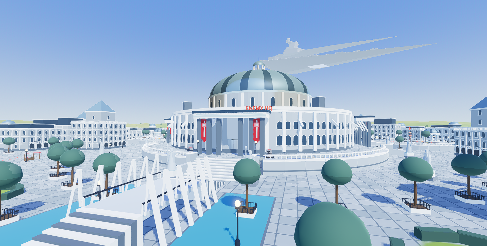
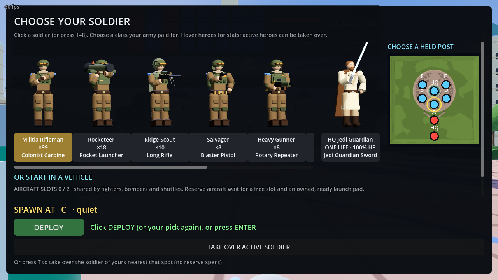
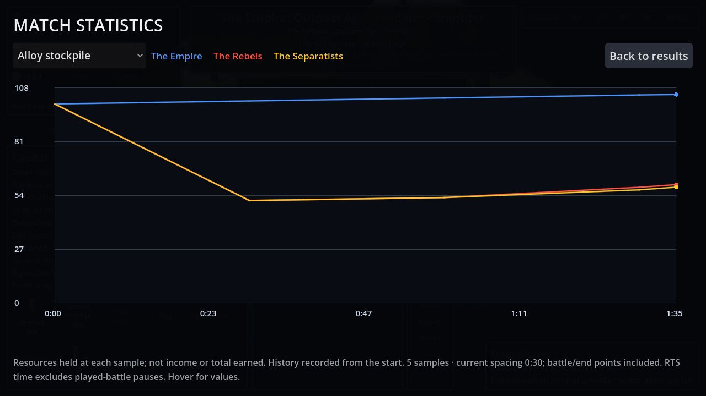
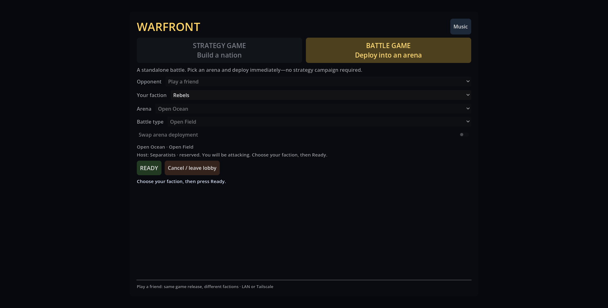
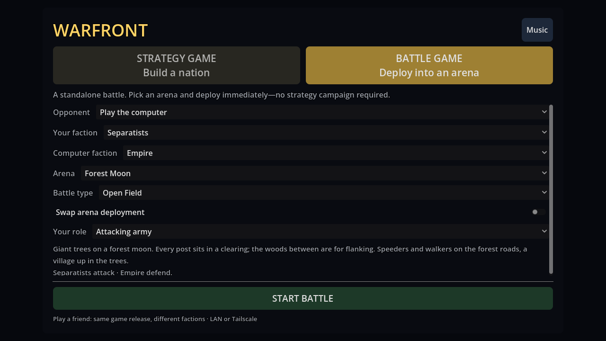

# WARFRONT

Build a nation on a strategy map, then fight its battles yourself, as a soldier on the ground.

WARFRONT is a real-time strategy game in the spirit of *Age of Empires* and *Rise of Nations*. When two armies meet, you can let the computer settle it, or drop into the battle as a classic-Battlefront-style third-person shooter: capture command posts, drive tanks, fly fighters, or command the whole army as its General. Every soldier your nation trained is one life in that battle.

Play alone against the computer, or with a friend on a second laptop.

## Download

- **[Download for Windows](https://github.com/cbeaver728/warfront-download/releases/latest/download/WARFRONT-win64.zip)** · Windows 10 or 11, 64-bit
- **[Download for Mac](https://github.com/cbeaver728/warfront-download/releases/latest/download/WARFRONT-macos.zip)** · macOS 13 or newer, Apple Silicon or Intel

[Latest release notes](https://github.com/cbeaver728/warfront-download/releases/latest) · [All releases](https://github.com/cbeaver728/warfront-download/releases)

**November 24 update:** [City routes and guardian cards](https://github.com/cbeaver728/warfront-download/releases/tag/warfront-2026-11-24-city-routes). Infantry and followers use city stairs, entrances and wall breaches; circular HQ landing traps are repaired. The defending guardian has a card beside the soldier roster, and final takeover can use surviving HQ rifle guards. City walls are **50% stronger**. Guardians still have one life. Includes the earlier three-faction battle selection and strategy updates. **Both players must update to this same release** (build **f1224e3**, protocol 12).

**Pre-holiday recheck, November 24:** the same Windows download passed 3,273 Core tests, 64 naval checks, shared battle/strategy-return tests, capital victory/Play on and saved multiplayer lobbies. Host/guest tests used simulated 160 ms added round-trip delay and 5% loss of movement/state packets. A 90-second normal-speed capital sample on Iris Xe, Low graphics at 1920×974, averaged **59.8 FPS** (49.2 FPS 1% low). These are local tests, not a guarantee for every PC or internet connection. Ground vehicles can still become congested near city terraces. The Mac archive was exported and structurally checked, but **has not been run on a Mac**; cloud jobs could not start.

**Sharing with friends:** online matches support **two human players** (host plus one guest). Both should extract and launch this same release. Use the stronger PC as host; try Low graphics on integrated GPUs. For different houses, [check that Tailscale establishes a direct connection](https://tailscale.com/docs/reference/connection-types)—a relayed connection can add latency. Avoid background downloads while playing.

## Install on Windows

1. Download the zip, right-click it and choose **Extract All**.
2. Open the extracted folder and double-click **WARFRONT.exe**. Keep the folder together: the game needs the files beside it.
3. If Windows says **"Windows protected your PC"**, click **More info**, then **Run anyway**. (The game isn't signed by a publisher, so Windows doesn't recognize it yet.)
4. If Windows Firewall asks about WARFRONT, allow it on **Private networks**. You only need that to play with a friend.

If **Smart App Control** blocks the game before it starts, this unsigned build may not launch on that PC. The [release notes](https://github.com/cbeaver728/warfront-download/releases/latest) record the current signing limitation; the source build remains available to the owner.

## Install on Mac

Unzip the download and move **WARFRONT.app** to **Applications**. Follow the Mac first-launch steps in the [latest release notes](https://github.com/cbeaver728/warfront-download/releases/latest).

To update on either platform, download the new zip and replace your old copy. Your saved games are stored separately.

## How to play

- **The strategy map:** choose the Strategy card, your faction, map and opponent. Against the computer, choose a difficulty. Train workers, build farms, lumber camps and mines, grow cities, research ages and raise armies. **Win by taking the enemy's capital.**
- **Standalone battles:** choose **Battle Game**, **Play the computer**, **Your faction** and a different **Computer faction**. Pick an arena/type and **Your role** (attacking/defending), then **START BATTLE**. All three factions work on every arena. Select **Play a friend** for a shared battle. Standalone results return to the main menu.
- **Battles:** when armies meet, choose **Simulate** (the computer settles it) or **Fight it yourself**. In a battle: WASD moves, the mouse aims, left click fires, **E** gets in and out of vehicles, **F1** shows all the controls and **Esc** opens the menu.
- **Save your game:** on the strategy map, **Esc → Save game**. On the start screen, pick it under **Saved games** to carry on.
- **Field engineers:** on foot, **F** selects turret or charge; **right click/G** starts or cancels work. Stay still for 25 seconds to finish a turret or 15 seconds for a charge. Each engineer life can complete one turret, even if that turret is later destroyed; **E** crews it. Once your charge is ready, **right click/G again** detonates it, then you can build another. Keep yourself and friendly troops clear. Board a damaged vehicle to repair it slowly after three seconds without hits.
- **Library research:** select a finished Library to buy wall or naval armor in Republic Age (90 seconds each), or Advanced Bacta Medicine in Galactic Age (120 seconds). These are optional purchases separate from advancing your age. One technology can research alongside an age; the world keeps running.

## Play with a friend

Both of you need **the same version** of the game: download the same release.

1. Choose **Strategy game** or **Battle game**, then **Play a friend** under Opponent. Host/join controls appear; computer difficulty is hidden.
2. The host selects a faction and world map or battle arena/type, then clicks **Host a game**. For battles, the host can attack or defend.
3. The guest enters the host's address and clicks **Join friend**. Choose an available faction—the host's faction is reserved and grayed out—then click **Ready**.
4. The host clicks **Start game**. A new strategy match has two human nations; a Battle match deploys directly into the arena.

**Same Wi-Fi:** use the host's Wi-Fi address. **Different houses:** both install [Tailscale](https://tailscale.com/download) and sign in with your own accounts. The host [invites the friend to their network](https://tailscale.com/docs/features/sharing/how-to/invite-any-user), or [shares the host computer](https://tailscale.com/docs/features/sharing) and the friend accepts. Use the host's **Tailscale address** (`100.x.y.z`).

In a strategy campaign, you each play your own nation on the same map. The defender chooses first when armies meet. If both choose to fight, you play on opposite sides in the same battle. If one chooses to fight, that player faces the computer. The battle is simulated when both choose computer control.

A two-player strategy game can be saved by the host (**Esc → Save game**) and picked up later: choose it under **Saved games → Host this game**. The guest joins and readies with their original saved faction; saved nations cannot be reassigned. Standalone battles do not create campaign saves.

## If something goes wrong

- **The game won't start, or looks wrong:** update your graphics driver (Windows Update → Advanced options → Optional updates, or your graphics maker's website).
- **Your friend can't connect:** use the same game release on both PCs, leave the host lobby open, and use the host's `100.x.y.z` address across different Wi-Fis. Separate Tailscale accounts need an accepted network invite or computer share. The host listens on **UDP 24680**. Windows Firewall lists the standalone game as WARFRONT; a source checkout runs under **Godot**, so allow the actual Godot executable instead. A TCP port test does not test this UDP game connection.
- **To report a problem:** press **Esc → Open log folder** and send the file `godot.log`, with what you were doing.

---

*WARFRONT is a free, unofficial fan project made for fun. It isn't affiliated with, endorsed by or connected to Lucasfilm, Disney, EA or the makers of Battlefront, Age of Empires or Rise of Nations. Music and some animations are free (CC0) works; see [CREDITS](CREDITS.md).*
