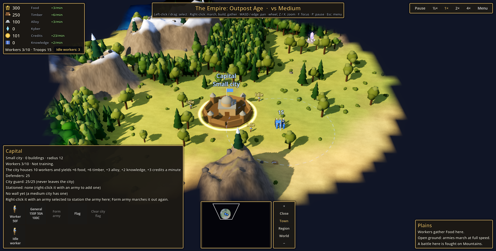

# WARFRONT

Build a nation on a strategy map, then fight its battles yourself, as a soldier on the ground.

WARFRONT is a real-time strategy game in the spirit of *Age of Empires* and *Rise of Nations*. When two armies meet, you can let the computer settle it, or drop into the battle as a classic-Battlefront-style third-person shooter: capture command posts, drive tanks, fly fighters, or command the whole army as its General. Every soldier your nation trained is one life in that battle.

Play alone against the computer, or with a friend on a second laptop.

## Download

- **[Download for Windows](https://github.com/cbeaver728/warfront-download/releases/latest/download/WARFRONT-win64.zip)** · Windows 10 or 11, 64-bit
- **[Download for Mac](https://github.com/cbeaver728/warfront-download/releases/latest/download/WARFRONT-macos.zip)** · macOS 13 or newer, Apple Silicon or Intel

[Latest release notes](https://github.com/cbeaver728/warfront-download/releases/latest) · [All releases](https://github.com/cbeaver728/warfront-download/releases)

**November 20 update:** [Retreat from remaining troops](https://github.com/cbeaver728/warfront-download/releases/tag/warfront-2026-11-20-retreat-current-stock). Retreat now returns half of actual living troops plus unused reserves by default, rounded down per unit type. Start with 200, lose 190 and retreat with ten left: **five return**. Only attackers may voluntarily retreat; defenders fight to the end. The result keeps post-battle penalties separate from field deaths. Includes the earlier combat, healing, aircraft repair, rally and navigation improvements. **Both players must use this release.**

## Install on Windows

1. Download the zip, right-click it and choose **Extract All**.
2. Open the extracted folder and double-click **WARFRONT.exe**. Keep the folder together: the game needs the files beside it.
3. If Windows says **"Windows protected your PC"**, click **More info**, then **Run anyway**. (The game isn't signed by a publisher, so Windows doesn't recognize it yet.)
4. If Windows Firewall asks about WARFRONT, allow it on **Private networks**. You only need that to play with a friend.

If **Smart App Control** blocks the game before it starts, this unsigned build may not launch on that PC. The [release notes](https://github.com/cbeaver728/warfront-download/releases/latest) record the current signing limitation; the source build remains available to the owner.

## Install on Mac

Unzip the download and move **WARFRONT.app** to **Applications**. Follow the Mac first-launch steps in the [latest release notes](https://github.com/cbeaver728/warfront-download/releases/latest).

To update on either platform, download the new zip and replace your old copy. Your saved games are stored separately.

## How to play

- **The strategy map:** pick a faction and a difficulty on the start screen. Train workers, build farms, lumber camps and mines, grow your cities, research new ages, and raise armies. **Win by taking the enemy's capital.**
- **Battles:** when armies meet, choose **Simulate** (the computer settles it) or **Fight it yourself**. In a battle: WASD moves, the mouse aims, left click fires, **E** gets in and out of vehicles, **F1** shows all the controls and **Esc** opens the menu.
- **Save your game:** on the strategy map, **Esc → Save game**. On the start screen, pick it under **Saved games** to carry on.

## Play with a friend

Both of you need **the same version** of the game: download the same release.

1. **On the same Wi-Fi:** one player clicks **Host a game** on the start screen and reads out the address it shows. The other types it in and clicks **Join**.
2. **From different houses:** both install [Tailscale](https://tailscale.com/download) (free) and sign in to the same Tailscale account. Then host and join as above, using the host's **Tailscale address** (it starts with `100.`).

You each play your own nation on the same map. The defender chooses first. If both players choose to fight, you play on opposite sides in the same battle. If one chooses to fight, that player faces the computer. The battle is simulated when both players choose computer control.

A two-player game can be saved by the host (**Esc → Save game**) and picked up later: the host chooses it under **Saved games** and clicks **Host this game**, and the friend joins as usual.

## If something goes wrong

- **The game won't start, or looks wrong:** update your graphics driver (Windows Update → Advanced options → Optional updates, or your graphics maker's website).
- **Your friend can't connect:** check the address, that you're both on the same Wi-Fi (not a guest network) or both on Tailscale, and that the host's Windows Firewall allows WARFRONT.
- **To report a problem:** press **Esc → Open log folder** and send the file `godot.log`, with what you were doing.

---

*WARFRONT is a free, unofficial fan project made for fun. It isn't affiliated with, endorsed by or connected to Lucasfilm, Disney, EA or the makers of Battlefront, Age of Empires or Rise of Nations. Music and some animations are free (CC0) works; see [CREDITS](CREDITS.md).*
